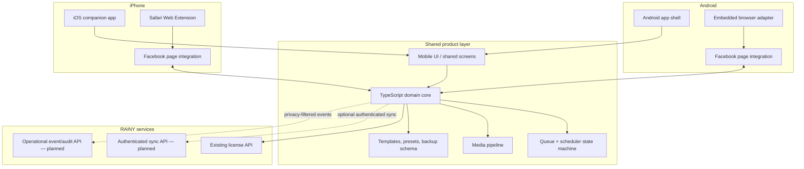

# RAINY FB Pro Mobile — Architecture & Parity Plan

**Target:** Android + iPhone  
**Compatibility baseline:** RAINY FB Pro Chrome Extension 5.8.0  
**Status:** Architecture foundation; feature parity is not yet achieved.

## Product decision

Build one shared mobile product with a shared TypeScript domain/core and platform-specific Facebook web integration. Do not attempt to run the desktop Chrome extension unchanged inside the native Facebook app.

- **Android:** RAINY mobile app shell with an embedded, controlled browser surface. The Facebook web experience is opened inside that surface; content-script integration is isolated behind an Android browser adapter. Evaluate GeckoView first because it provides a browser engine and extension-oriented integration surface. A WebView fallback must not be treated as equivalent without proving content-script, file-upload, cookie/session, and background behavior.
- **iOS:** RAINY companion app plus a Safari Web Extension for Facebook pages opened in Safari. iOS does not permit injecting this integration into the native Facebook app or an arbitrary third-party browser. App and extension share the same domain/core package through a versioned message contract.
- **Shared services:** existing RAINY license service remains the source of truth for license/trial state. Mobile local persistence is an offline cache, not the license authority. Cross-device sync requires authenticated server APIs and must not be simulated with local storage.

## Architecture

## Shared contracts

1. **Domain core:** platform-independent validation, group/preset models, post drafts, queue transitions, duplicate guard, schedule calculations, media metadata policy, CSV/backup serialization, and license-state presentation.
2. **Browser adapter:** capability-detected interface for current tab/page, visible group context, file selection, user-confirmed page actions, and safe result reporting. No platform-specific API calls inside domain logic.
3. **Message protocol:** versioned, schema-validated messages between app and browser extension. Reject unknown message versions and untrusted origins. Never pass Facebook cookies, passwords, or raw session tokens to the companion app.
4. **Queue state machine:** `PENDING → RUNNING → SUCCEEDED | FAILED | UNKNOWN | NEEDS_USER`. A timeout after a submit action becomes `UNKNOWN`; never blindly retry an uncertain post. Checkpoint, permission errors, rate limits, and policy blocks pause the queue.
5. **Persistence:** encrypted platform storage for sensitive settings; IndexedDB/files only for non-sensitive offline drafts where appropriate. Server-side sync is opt-in and authenticated. Backups exclude credentials and session data.
6. **Observability:** redact post body, phone numbers, cookies, tokens, and uploaded media from logs by default.

## 5.8.0 feature parity register

Parity is measured per platform and per user-visible workflow. A feature is not marked complete because a button exists.

| Desktop 5.8.0 capability | Shared implementation | Android target | iPhone target | Acceptance evidence |
|---|---|---|---|---|
| Post text and image drafts | Shared draft model | App UI + browser adapter | App UI + Safari extension | Draft survives restart; image attaches |
| Templates / examples | Shared template repository | Native UI | Native UI | CRUD + import/export tests |
| Group links, lists, batches, presets | Shared group model | Browser page discovery | Safari page discovery | Selected groups persist and resolve |
| Ordered multi-group queue | Shared queue state machine | Foreground browser runner | Safari foreground runner | Order, pause/resume/stop, recovery tests |
| Per-group delays | Shared scheduler | Foreground timers; background limits disclosed | Foreground timers; iOS suspension limits disclosed | Deterministic fake-clock tests |
| Smart Scheduler / recurring schedules | Shared schedule engine | OS background task where permitted | BGTaskScheduler where permitted | Time-zone and missed-run tests; no exact-time guarantee in suspended app |
| Duplicate-post protection | Shared fingerprint + idempotency record | Same shared logic | Same shared logic | Repeated submit is blocked; UNKNOWN is not retried |
| Multi-image handling / compression / EXIF removal | Shared media pipeline | Native picker + processing | Photo picker + processing | EXIF stripped and size/format verified |
| Lead Finder / visible ad phone extraction | Shared parsing/export logic | Visible page content only | Visible Safari page content only | Consent/permission boundary and CSV tests |
| Progress and operation logs | Shared event model | Native UI | Native UI | State transitions accurately rendered |
| License / trial / payment status | Existing license API adapter | API-backed | API-backed | Online state and offline-expiry behavior tested |
| Backup / restore / CSV export | Versioned shared schema | Share sheet/files | Share sheet/files | Round-trip and schema migration tests |
| Protection / checkpoint handling | Shared stop policy | Browser adapter signals | Safari adapter signals | Block/checkpoint pauses; no evasion |

## Platform constraints and non-goals

- Neither platform can inject into the native Facebook app.
- iOS Safari extension only operates on supported Safari web pages after the user enables/grants access. It cannot run inside Facebook's native app.
- Android browser integration must be validated against Facebook's mobile web UI. Facebook DOM changes can break automation.
- Background execution is OS-controlled. Exact-time unattended posting cannot be promised when the app/browser is suspended or terminated.
- Do not bypass Facebook checkpoints, rate limits, permissions, or anti-abuse controls. Require user confirmation for page actions where the platform requires it.
- Do not store or transmit Facebook credentials/cookies in RAINY backend.
- No claim of identical automation until Android and iOS device-level acceptance tests pass.

## Delivery phases

### Phase 0 — foundation (this change)
- Freeze the 5.8.0 capability register and platform constraints.
- Define shared contracts, state machine, security boundaries, and parity evidence.
- Add automated architecture regression tests.

### Phase 1 — shared core extraction
- Inspect existing extension queue, scheduler, media, lead, backup, and license logic.
- Add characterization tests before moving logic.
- Extract platform-neutral TypeScript modules without changing desktop extension behavior.
- Add adapters for Chrome MV3, Android browser, and Safari Web Extension.

### Phase 2 — Android vertical slice
- Build app shell and embedded-browser proof of concept.
- Validate Facebook login/session, group discovery, file upload, queue pause/resume, and visible progress on real Android devices.
- Do not enable unattended/background posting until reliability and platform policy checks pass.

### Phase 3 — iPhone vertical slice
- Build companion app and Safari Web Extension target.
- Implement versioned native messaging and permission onboarding.
- Validate Safari Facebook web pages, file/photo access, extension lifecycle, and iOS suspension behavior.

### Phase 4 — feature parity and release
- Complete every row in the parity register on both platforms.
- Device matrix: current and previous major Android/iOS versions, small and large screens.
- Run unit, integration, browser, and physical-device tests.
- Ship staged beta builds; only mark 5.8.0 parity complete after evidence is attached for every supported feature.

## Definition of done

- Every parity-register row has automated tests and a device-level acceptance record for both platforms.
- Queue never reports success without positive confirmation; ambiguous submits become UNKNOWN.
- No secrets or Facebook session material appear in app storage, backups, or logs.
- Accessibility, offline draft behavior, backup migration, license handling, and app/extension version compatibility are tested.
- Store-policy and Facebook platform-policy review completed before public release.
